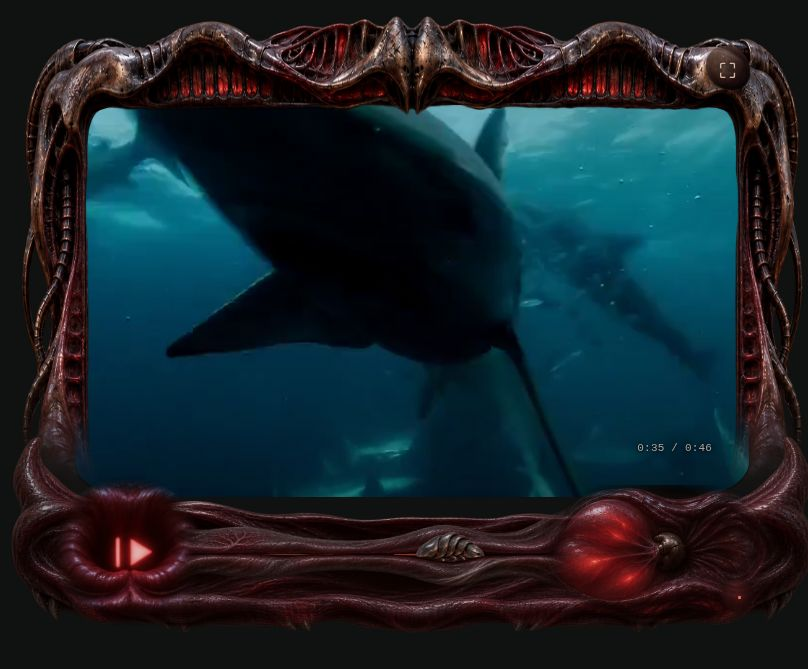
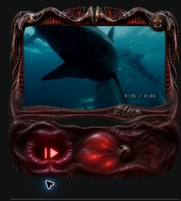
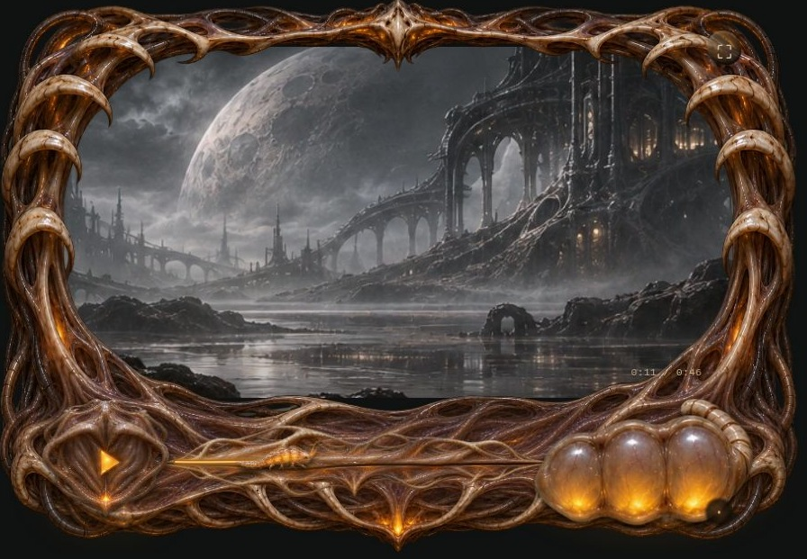
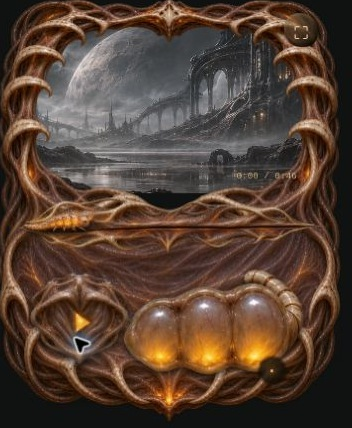
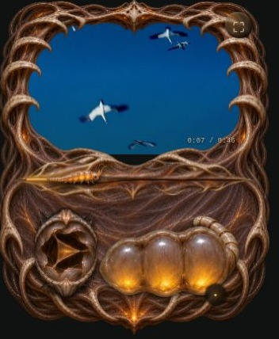
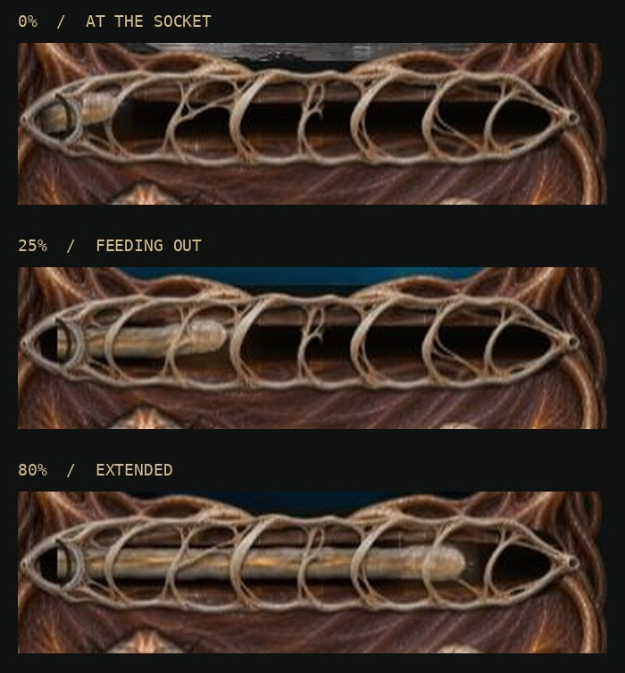

# Viscera — living Video.js skins

An experimental biomechanical player with four skins: Maw, Leech, Thorax, and Chrysalis.

[Open the hosted player](https://living-specimens.nickchadwick187.chatgpt.site)

## Responsive organism

Maw uses a shared transparent frame and muscle mantle around its moving organs.
The foreground mantle overlaps sprite boundaries, and the rail samples the
continuous middle of its painting so standalone end sockets do not break the join.
The control layout follows the player's own width with a container query. Wide
players use one row; compact players put the scrubber above pause and volume.
Keyboard focus illuminates the organ contour instead of a rectangular panel.





Browser review covered viewport widths 320, 390, 560, 800, 844, 1000, 1200 and
1440 pixels, including live resizing across the layout transition. Seek and
volume values survived resizing with no horizontal overflow.

## Run locally

Serve the static output directory over HTTP:

```sh
python3 -m http.server 8000 --directory dist
```

Open http://localhost:8000. No package installation or build is required.

## Maw interactions

- The play/pause organ uses a 15-pose image-generated atlas. Playing inflates it into two bars. Pausing deflates it into a bar and triangle. Activating it during a transition reverses from the current pose.
- The scrubber uses continuous, uniquely mapped tissue artwork with separate back and foreground layers. End sockets keep their size as the middle stretches.
- A localized deformation follows the grub. Direction and velocity control gathering and the relaxing wake.
- The grub uses eight generated squirm poses. Drag speed increases animation speed.
- WebGL draws textured meshes and adds contact darkening, internal progress illumination, and subtle wet highlights.
- Canvas fallbacks use the same artwork and animation. Native HTML buttons and range inputs retain keyboard and accessible labels.

## Files

- `dist/app.js` — playback and skin selection.
- `dist/maw-button.js` — sprite state transition and shader.
- `dist/maw-scrubber.js` — mesh rendering, Canvas fallback, dragging, squirm loop.
- `dist/tissue/scrubber/` — image-generated continuous rail layers and grub atlas.
- `dist/vendor/` — locally bundled Video.js 10.3.0 modules.

## Current limits

The preview browser disables WebGL, so browser verification covered the Canvas fallback, seeking, rapid direction changes, endpoints, playback, and skin switching. WebGL visuals and fullscreen still need device verification. The responsive layouts were reviewed in resized browser viewports, rather than on physical iOS hardware. Generated sprite poses retain some fine-detail variation. Highlight normals are approximate rather than physical normal maps.

The bundled Oceans clip is the Video.js demonstration video. Video.js is third-party open-source software. Artwork was generated with image generation tools and prepared through several reference-guided passes.

## Thorax: costal reflex

Thorax is rebuilt as one composited organism. Its ivory skeleton and tendon bed
share a single scene with the moving organs. A separate compact body painting
keeps the ribs in proportion when the controls fold into two rows below 560px
of **player** width. The outer frame uses nine-slice mapping; connecting membrane
absorbs changes in width and height without stretching the foreground organs.

- The living iris has 30 authored poses. Its membrane petals close while playing
  and open to reveal the amber Play membrane when paused. A one-second
  transition reverses from the current pose, including rapid toggles.
- The volume creature has a fixed shell, head and legs, independently animated
  membranes that fill and empty with the volume level. Click or
  drag across its sacs: right increases actual Web Audio gain, left decreases it.
  The head toggles mute and restores the previous level.
- The scrubber extracts a continuous worm through stationary ribs. Its skin is
  mapped back from the head, so markings feed out of the socket instead of
  stretching across the visible length. Pulling thins the neck; pushing gathers
  the body; release sends a damped contraction back through the tissue.
- Nine registered head poses blend into the continuous body. The whole head and neck pass
  behind the ribs, preserving consistent depth through every opening.
- All organs share a slow respiratory phase, localized contact shadows, and
  amber spill light on the surrounding tissue, even while paused.
- A WebGL post pass adds warm bloom and local soft-tissue displacement. The
  Canvas renderer retains the full artwork, deformation and control behavior.
- Sprite frames blend on a separate premultiplied surface so interpolation
  doesn't dim their shared pixels. Rendering is capped near 30fps, with DPR
  capped at 1.65, and stops when inactive, hidden, or resting with motion off.
- Real buttons and sliders remain accessible underneath the scene. Native
  pointer capture supports dragging; keyboard focus illuminates the anatomy.

Implementation: `dist/thorax.js`, `dist/thorax.css`, and
`dist/tissue/thorax-*-v2.webp`. Production studies and generation specifications
are in [docs/thorax](docs/thorax/production.md).

Review covered live resizing from 320–1440px viewport width, compact/extended
layout changes, pointer dragging, seeking, play/pause, volume during playback,
mute restoration, and switching between Maw and Thorax. The browser used the
Canvas fallback; WebGL appearance and physical iOS output remain unverified.





The approved iris study is integrated in `dist/tissue/thorax-iris-v3.webp`
(six columns by five rows). A cached canvas matte removes the surrounding dark
backdrop while preserving the cavity shadow. The same scene supplies breathing,
contact light, and keyboard focus.



## Thorax worm extraction

Implementation: `dist/thorax-worm.js` and `dist/worm-motion.js`. Generated art,
rendering decisions, and verification are documented in
[worm production notes](docs/thorax/worm/production.md).



The Thorax volume animation and browser review are documented in
[volume production notes](docs/thorax/volume/production.md).

The public repository streams the demo from https://vjs.zencdn.net/v/oceans.mp4. The hosted build bundles that same demo clip locally.
