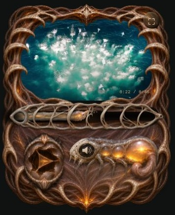
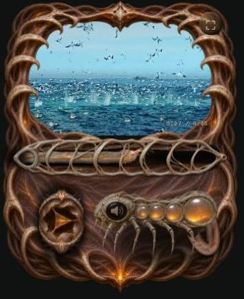

# Thorax curled volume creature

The approved compact insect replaces the three-sac marrow volume organ.
The fixed ivory head is the mute button. The upper amber sacs form one
continuous left-to-right range input. Pointer down maps directly to the touched
position, pointer capture continues outside the area, and Right/Up increase
while Left/Down decrease. Home/End select 0/100. Existing Web Audio gain control
remains the audio engine.

## Authored animation

`dist/tissue/thorax-volume-creature-v1.webp` contains 30 authored poses, six
columns by five rows, with 384 × 240 cells. A reference-guided image-generation
pass used the approved three-state study as anatomy and motion authority.
The brief preserved the perforated ivory left head, speaker medallion, graduated
translucent amber chambers and six leg roots. It requested sequential inflation
and a changing appendage silhouette: loose long U beneath the head at 0%,
smaller central C at 50%, tight rear hook beneath the largest sac at 100%.
The root stays attached and the maximum footprint remains compact. Frames use
one fixed crop and scale, preserving the authored anatomy.

The renderer isolates each frame and cleans detached alpha residue before
sampling. Premultiplied adjacent-frame blending preserves opacity. The displayed
pose eases toward the actual level while audio responds immediately; direction
can reverse at any point. Shared respiration, contact compression, amber spill,
shadows and the existing optional WebGL postpass connect the creature to Thorax.
Reduced motion selects the current volume pose directly. Ambient-off leaves
interaction transitions available.

[Inflation and return study](inflation-study.gif)

## Browser verification

- Click at the sac midpoint selected 50% and actual Web Audio gain 0.5.
- While playback continued, Right increased 50% to 55%.
- Native pointer drag right raised the level to 87%; reversing lowered it to 9%.
- The head muted and restored the previous 55% setting during playback.
- Home and End selected the silent/full endpoints.
- Live iframe resizing between 320, 390 and 1000px preserved volume and media
  position, switched folded/extended layouts, and produced no horizontal overflow.
- The final full-width preview also rendered the complete integrated anatomy.
- Nine existing mechanics/audio/matte tests passed; JavaScript syntax checked.

Visual checks used the Canvas renderer because this browser disables WebGL.
The optional WebGL enhancement and physical iOS device performance remain
unverified. The GIF is an authored sprite study, not a live player recording.

## Firm anatomy revision

The 30-pose whole-creature atlas is superseded by independently rendered parts:

- `dist/tissue/thorax-volume-shell-v2.webp`: a new fixed perforated ivory head,
  chamber rims and articulated legs; its open windows have true transparency.
- `dist/tissue/thorax-volume-sacs-v2.webp`: fifteen isolated membrane poses,
  five columns by three rows. The image-generation brief retained the original
  translucent chambers, fine veins, fixed organ positions and controlled amber
  glow, with collapsed folds progressively becoming taut.
- `dist/tissue/thorax-volume-tendon-v2.webp`: tissue sampled from the approved
  earlier appendage painting, mapped uniquely along a continuous curved ribbon.

The rigid-layer brief preserved the approved creature's head, medallion, thin
legs and chamber roots while removing all soft tissue for independent compositing.
The generated shell is shaded to match Thorax. It stays fixed as the membranes
change. The sacs respond with a 28/s exponential approach; a separately damped
appendage follows their pressure and recoils after reversals. Its root remains
fixed. A single ribbon silhouette clips texture sampling, preventing strip seams.
The WebGL pass no longer displaces the whole volume organ and applies less
bloom there. Recess shadows create dark separation beneath the legs.

The iris's visible painting is 18% smaller, with its HTML touch target unchanged.
A soft recess and restrained spill embed the rim in the tendon bed.

Eleven tests pass, including a new check that sacs lead the curl and both settle
after reversal, with immediate stable reduced-motion endpoints. Browser review
covered 320, 390 and 1000px viewports, no horizontal overflow, volume and media
state across resizing, volume during playback (55% actual Web Audio gain), mute
restoration, and the smaller play control. Canvas was verified; physical iOS and
WebGL appearance remain unverified.

## Sac-only volume control

The dangling appendage and its recoil simulation have been removed. Only the
sac membranes fill and empty; the head, shell and legs remain fixed. The tendon
texture is no longer loaded. Left-to-right interaction, mute restoration and
quick membrane easing are unchanged. The motion test now verifies filling,
emptying, render scheduling until settled, and reduced-motion behavior.
