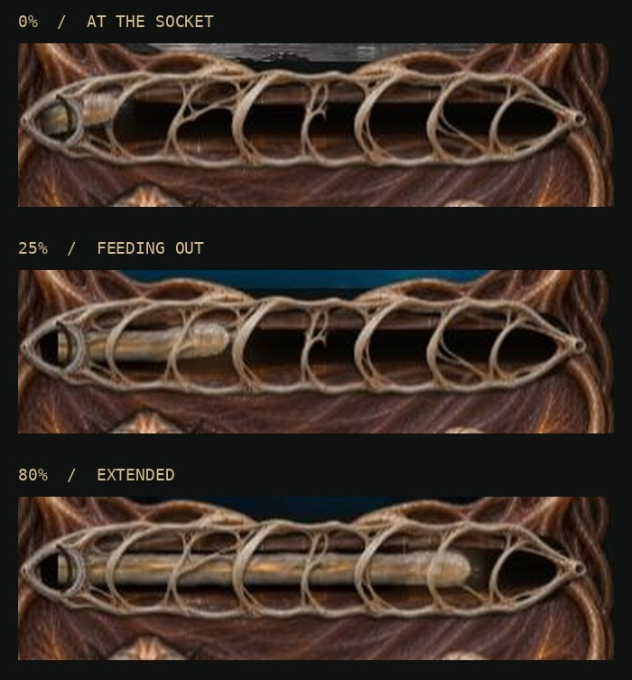
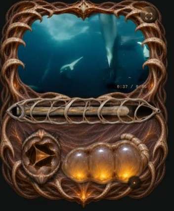

# Thorax worm extraction

The former small grub is replaced with a long worm drawn out through a fixed
ivory cage. The tube lining yields around it; the skeleton stays stationary.

## Generated assets

Three reference-guided image-generation passes produced:

- `dist/tissue/thorax-worm-skin-v1.webp`: one unique panoramic cylindrical skin,
  translucent grey ivory with irregular annular creases, fine veins and an amber
  gut. No repeated tiles, head, tail, legs or armor. Cropped and encoded at
  2048 × 615.
- `dist/tissue/thorax-worm-head-v1.webp`: nine transparent poses of one blunt,
  pale worm head facing right, with tiny feelers and a short neck. The alpha-
  weighted neck attachment was registered into 512 × 280 cells, three by three.
- `dist/tissue/thorax-worm-cage-v1.webp`: a stationary transparent skeletal rail,
  with seven irregular ivory ribs, extraction socket and terminal. Open windows
  expose the worm behind it. Cropped to 2019 × 359.

The art direction retains Thorax's pale bones, wet translucent membranes and
amber internal light. Maw's armored grub is not reused for this worm.

## Rendering and motion

`thorax-worm.js` draws a continuous silhouette and uniquely sampled skin strips.
Source coordinates are measured backward from the head over the available
travel length. Increasing progress exposes more skin; it does not stretch one
visible image to fit. At the socket, source coordinate equals 1 minus progress,
even after resizing. Shadows are applied to the silhouette, not each sampling
strip, preventing the old segmented appearance.

A 40-node spring model in `worm-motion.js` supplies lateral motion and radius.
Pulling narrows the body; returning it thickens and gathers it. Release produces
a decaying contraction wave. Quiet ambient movement remains while paused.
Reduced motion resets the simulation to a stable state.

The registered head poses blend on a cached premultiplied canvas, with a soft
neck matte. The complete head, neck and body draw behind the fixed cage, so every rib
consistently occludes the worm. The skin extends beneath the full extraction
socket and a feathered elliptical cavity shadow softens its entry. The existing continuous tendon painting
provides deformable tube lining. Contact shadows, amber spill and fine adhesive
threads join the layers in the shared Thorax scene.

## Verification

Seven tests passed across worm mechanics and media audio. Worm tests cover
material mapping, responsive endpoints, directional strain and relaxation,
chaotic reversals and long time gaps, and resize invariance.

Browser checks covered viewport widths 320, 390, 640, 844 and 1440; folded and
extended layouts; dragging in both directions and outside the rail; 0 and 100
percent endpoints; paused-first seeking; playback; volume during playback; and
skin switching. Progress, volume and source material survived resizing without
horizontal overflow. A paused-first seek now reveals the actual video frame.

The browser used Canvas because WebGL was unavailable. The existing WebGL
postprocess remains available but its visual output was not verified here.
Physical iOS performance remains unverified.

## Original creature head restoration

The v2 head atlas replaces the blunt head with anatomy guided by the original
Thorax reference: wet translucent lobes, an amber gut, a dark sensory pit,
small mouth appendages, and four long probing feelers. Nine generated poses
are cropped and registered at their neck attachment in 400 × 360 cells. The
renderer anchors the neck at 75% cell height to leave room for the feelers.
The entire sprite continues to draw behind the fixed ribs.

Generation brief: a transparent 3 × 3 atlas of the same right-facing creature,
with a fixed neck, consistent translucent beige anatomy and amber organ
positions, subtle head contractions and probing feelers, a near-matching first
and last pose, and no bones, background, labels or scenery. The original head
was the anatomy reference; the previous atlas supplied attachment/layout only.

## Forward probing feelers

The v3 head atlas retains the nine poses and original anatomy, but directs
the four upper mouth feelers forward along the tube. Their shallow arc stays
close to the top of the fleshy head instead of rising out of the ribcage.
The image-generation edit preserved scale, fixed neck attachment, amber organs,
transparency and cell layout; only the feelers' direction and length changed.
